# ✨ 루미 스텔라: 별빛의 씨앗 (Lumi Stella: Seeds of Starlight)
> **몬스터 수집·배틀 RPG에 자급자족 농경·생활 시뮬레이션을 결합한 2.5D/3D 디오라마 멀티플레이 웹 게임**

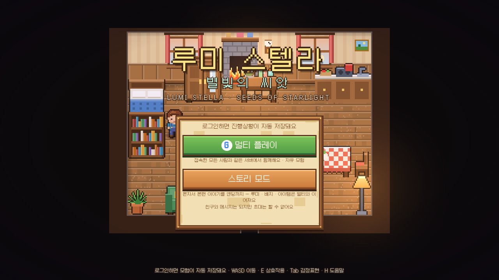

---

## 1. 프로젝트 개요 (Project Overview)

| 항목 | 내용 |
|---|---|
| **프로젝트명** | 루미 스텔라: 별빛의 씨앗 (`Lumi Stella: Seeds of Starlight`) |
| **장르** | 2.5D/3D 디오라마 몬스터 수집·육성·배틀 RPG + 농장·채집·제작 생활 시뮬레이션 |
| **플랫폼** | Web (Desktop 키보드/마우스 + Mobile 가로 양손 가상 패드 대응) |
| **핵심 차별점** | 회복약·도핑약·포획볼·탐험 장비를 상점에 의존하지 않고 **내 밭과 17개 마을 특산물·광산에서 직접 자급자족**하는 RPG 순환 구조 |
| **플레이 볼륨** | 본편 1~10장 (8대 체육관 기믹 퍼즐 → 루미 리그 → 엔딩) + 포스트게임 (네 방향의 탑 · 전설/환상 루미) 약 25~35시간 분량 |
| **배포 환경** | 프론트엔드 **Vercel** (Vite) · 백엔드 **Azure App Service** (Node.js + Socket.io) · DB/인증 **Firebase Auth & Firestore** |

### 핵심 정량 지표 (Key Metrics)

| 지표 | 수치 | 비고 |
|---|---:|---|
| **애플리케이션 코드** | **27,544 LOC** (75개 TS 모듈) | Client / Shared Simulation / Authoritative Server |
| **절차적 생성 파이프라인** | **13,126 LOC** (48개 도구 스크립트) | 코드 기반 픽셀아트 · 맵 생성기 · 자동 검증기 |
| **월드 규모** | **178개 맵** | 18개 마을 · 77장 도로 · 35개 던전/탑 · 8대 체육관 퍼즐 · 교도소 |
| **수집 콘텐츠** | **루미 122종 + 생활 도감 90종** | 농사 30 · 채광 30 · 낚시 30 + 전설/환상 루미 |
| **비주얼 & 사운드** | **일러스트 210종 · BGM 28곡** | Gemini AI 화풍 통일 일러스트 + 파일 없는 WebAudio 합성 |
| **품질 보증** | **워프·도달성 결점 0건** | 178개 전체 맵 자동 도달성 검사(`check-paths.mjs`) 통과 |

---

## 2. 핵심 게임플레이 & 콘텐츠 구성

### 2-1. "자급자족 모험 보급" 코어 루프
기존 몬스터 수집 RPG가 골드로 상점 아이템을 구매하는 단선적 소비 구조라면, **루미 스텔라**는 모험과 생활이 서로를 견인하는 순환 루프를 설계했습니다.

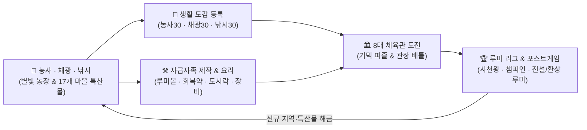

### 2-2. 개인 농장 & 멀티플레이 소셜 라이프
- **별빛 농장(개인 공간)**: 잡초 뽑기·벌목·채광·개간·설치물 배치(울타리·상자·가로등 등)가 가능한 나만의 공간. 우편함으로 친구를 초대하면 함께 밭을 가꾸고 식탁에서 음식을 나눠 먹을 수 있습니다.
- **17개 마을 공용 텃밭 & 주민 호감도**: 마을별 특산 씨앗을 본고장 텃밭에서 사계절 재배할 수 있으며, 주민 호감도를 높이면 자동 물주기·수확 도우미로 협력합니다.
- **포만감 & 요리 시스템**: 야외 모험 중 포만감(`0~100`)을 관리하며 집 부엌·모닥불에서 도시락 10종을 조리합니다. (접근성을 위해 휴대폰 설정에서 **편한 모드** 토글 제공)

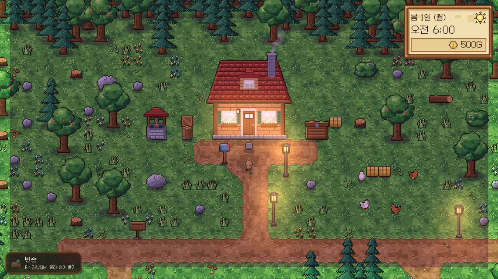

### 2-3. 루미나 지방 대륙 설계 (178개 맵 · 8대 체육관 퍼즐)
- **대륙 + 항구 정기선 구조**: 하나의 대륙을 걸어 탐험하고, 보름달섬·무쇠섬·왕관 시티(리그 섬) 등은 항구 부두의 정기선 출항 연출로 이동합니다.
- **8대 체육관 고유 기믹 퍼즐**: 스위치 게이트, 3단 수위 조절, 소코반 밀기 블록, 함정 발판, 빙판 눈덩이, 워프 미궁 등 체육관마다 독자적인 퍼즐 실내를 구현했습니다.

| 루미나 지방 코드 생성 월드맵 | 17개 마을 · 29개 도로 연결 그래프 |
|---|---|
| 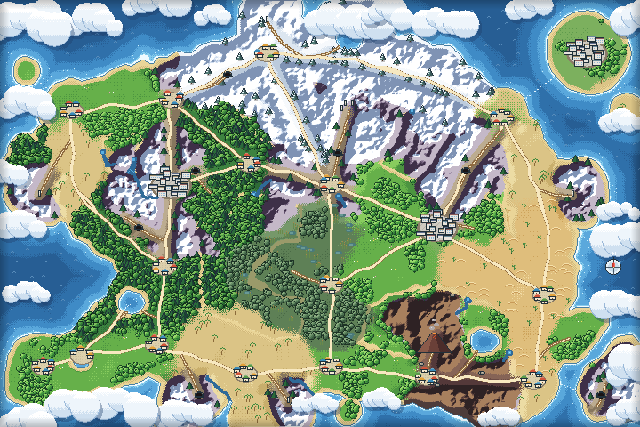 | 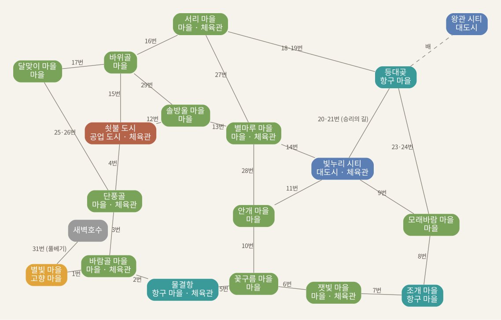 |

### 2-4. 탐험 · 턴제 배틀 · 포스트게임 엔드게임
- **셀룰러 오토마타 동굴 & 파트너 필드 스킬**: 시드 기반 동굴 생성과 파트너 루미의 바위 부수기·파도타기·자동 물주기 등 속성별 필드 보조 능력을 연동했습니다.
- **포스트게임 시네마틱**: 본편 챔피언 격파 후 수정 미로(전설 **별무리**), 해신의 바다 조류 비석 퍼즐(전설 **해랑**), 시련의 오카리나 리듬 퍼즐과 네 방향의 탑(전설 **스텔라**), 그리고 구름 위 태초의 길(환상 **제네시스 Lv.150**)까지 완결된 엔드게임을 제공합니다.

| 셀룰러 오토마타 동굴 & 필드 스킬 | 전설의 루미 '별무리' 배틀 연출 |
|---|---|
| 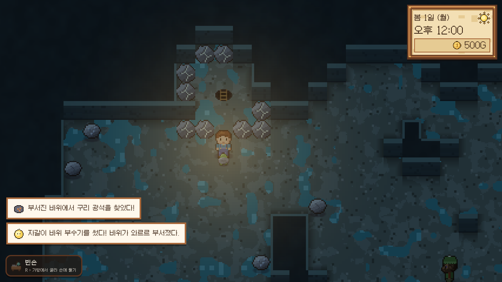 | 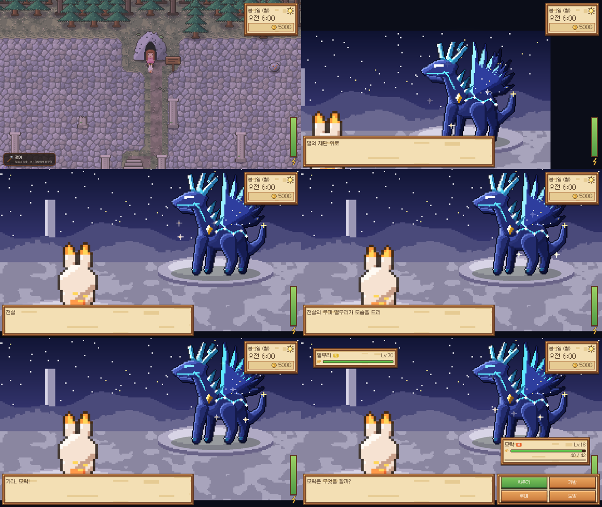 |

| 시련의 오카리나 & 네 방향의 탑 | 환상의 루미 '제네시스' 시네마틱 & 배틀 |
|---|---|
| 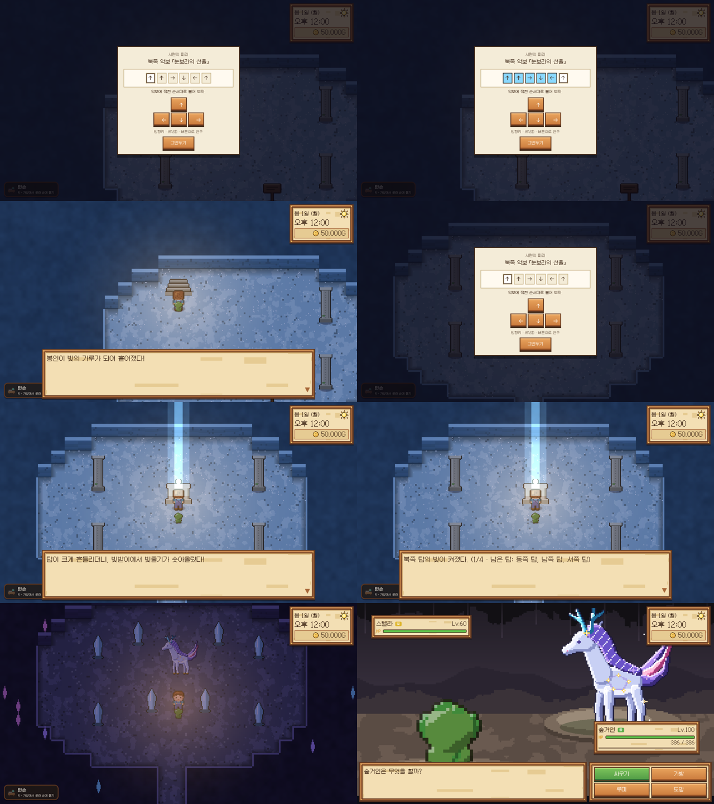 | 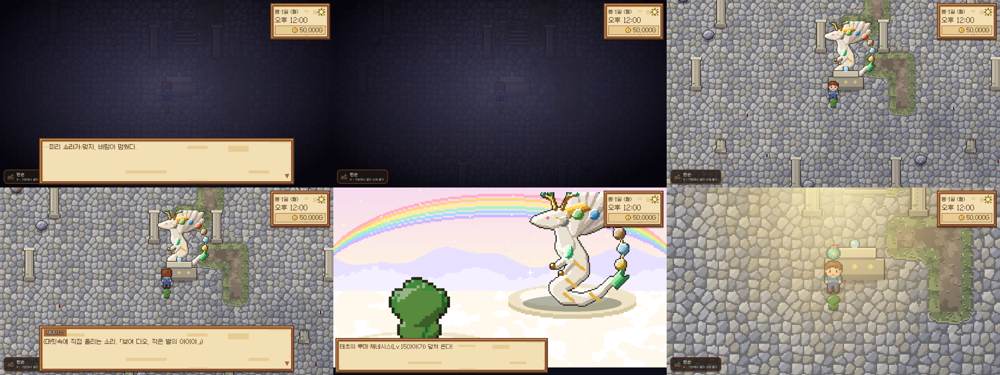 |

---

## 3. 핵심 기술 아키텍처 (Technical Architecture)

### 3-1. 전체 시스템 아키텍처

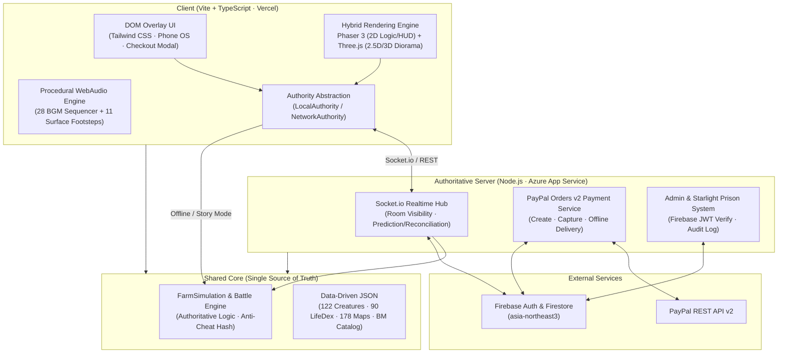

### 3-2. 하이브리드 2.5D/3D 디오라마 렌더링 (Phaser 3 + Three.js)
- **입체 지형 + 2D 도트 빌보드 조합**: `Stage3D.ts`, `Interior3D.ts`, `BattleStage3D.ts`, `Fx3D.ts`를 통해 Tiled JSON 맵 데이터(`Cliff` 레이어, 3단 테라스, 계단, 점프 턱)를 Three.js 3D 메시로 실시간 구축하고, 캐릭터·나무·소품은 픽셀아트의 선명함을 유지하는 2D 빌보드로 배치했습니다.
- **실시간 환경 연출**: 시간대별(새벽·낮·노을·밤) 조명 및 실내 창문 색상 동기화, 비·눈·화산재 파티클, 가로등 발광, Y-Sort 깊이 정렬 및 건물 뒤 반투명 처리를 지원합니다.

| 3D 디오라마 마을 (3단 테라스 · 계단 · 빌보드) | 3D 디오라마 대도시 (왕관 시티 원근 투시) |
|---|---|
| 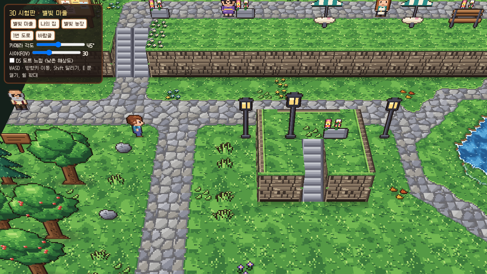 | 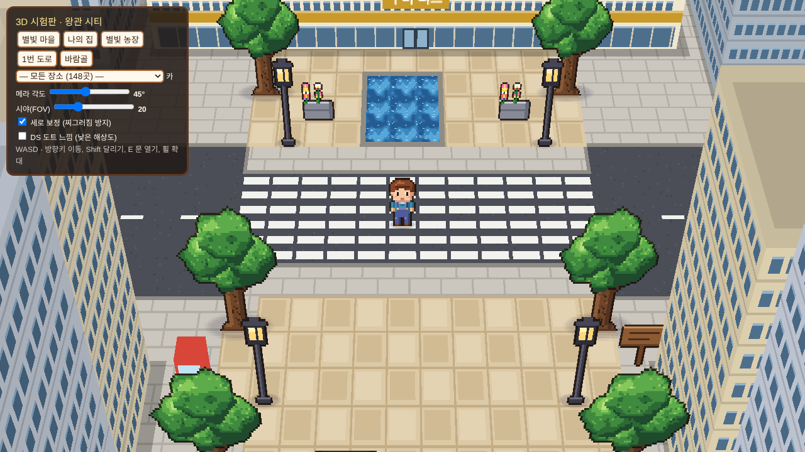 |

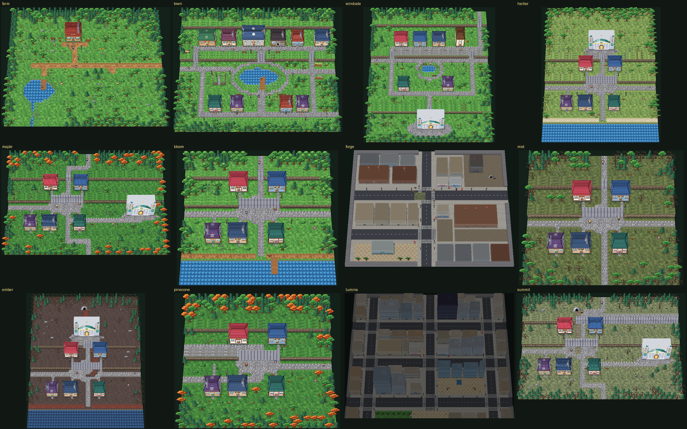

### 3-3. 서버 권한(Authoritative) 멀티플레이어 & 싱글/멀티 통합 설계
- **`Authority` 추상화 패턴 (`client/src/net/Authority.ts`)**: 클라이언트는 상태 변경을 직접 수행하지 않고 `ActionIntent`(도구 사용, 구매, 배틀 명령 등)만 발행합니다. 멀티플레이 시 `NetworkAuthority`가 Socket.io로 서버에 전달하고, 오프라인/스토리 모드에서는 동일한 `shared/sim/FarmSimulation.ts`를 브라우저에서 구동하는 `LocalAuthority`가 처리하여 **싱글·멀티 간 코드 중복을 0%로 유지**했습니다.
- **실시간 이동 동기화**: 로컬 플레이어는 즉각 반응하는 **Client-side Prediction**을 적용하고, 서버가 속도·충돌을 검증해 이상 시 `correct` 패킷으로 **Reconciliation(보정)**합니다. 원격 플레이어는 **110ms 버퍼 선형 보간(Entity Interpolation)**으로 부드럽게 렌더링됩니다.
- **방(Room) 단위 가시성 격리**: 개인 공간(별빛 농장·집)은 주인과 우편함 초대 친구만 동기화하고, 마을·도로·상점 실내는 전 접속자와 공유하는 하이브리드 인스턴싱을 구현했습니다.

### 3-4. 제로 외부 에셋 파이프라인 & 자동 검증 (Procedural Pipeline)
- **코드 생성 픽셀아트 (`tools/art/*.mjs`)**: 외부 이미지 편집 툴이나 상용 에셋 없이, Node.js 내장 `zlib`만으로 PNG를 인코딩하는 자체 드로잉 파이프라인으로 타일셋(바이옴별 9종), 캐릭터 애니메이션, 루미 122종, 실내 가구, 지방 월드맵을 100% 코드로 생성합니다.
- **선언적 월드 생성 & 자동 도달성 검증 (`tools/map/`)**: `region-spec.mjs` 설계도 하나로 178개 맵의 지형·워프·트레이너·체육관 퍼즐·셀룰러 오토마타 동굴(`cavegen.mjs`)을 일괄 생성합니다. 이후 `check-world.mjs`(워프 무결성)와 `check-paths.mjs`(BFS 기반 체육관 기믹·파도타기 포함 전 맵 도달성 검사)를 실행해 **결점 0건**을 보장합니다.
- **AI 대화 일러스트 파이프라인 (`tools/art/gen-illust.mjs`)**: 도트 초상화를 레퍼런스 이미지로 첨부해 Gemini REST API로 인물 210종의 일관된 화풍 일러스트를 자동 생성·후처리(배경 제거)했습니다.
- **실시간 WebAudio 합성 엔진 (`client/src/audio/`)**: 오디오 파일 없이 WebAudio API로 펄스파·삼각파·노이즈 채널을 합성해 28곡의 오리지널 BGM 시퀀서(`Music.ts`)와 **11종 바닥 재질별(흙·풀숲·돌길·눈·동굴 등) 발소리 및 상호작용 효과음**(`Sfx.ts`)을 구현했습니다.

### 3-5. 보안 · 안티치트 · 게임화된 제재 시스템 (Starlight Prison)
- **무결성 검증 (`shared/sim/antiCheat.ts`)**: 오프라인/로컬 세이브의 재화(골드·캐쉬) 및 수감 상태를 **FNV-1a 기반 결정론적 해시 서명(`computeSaveSig`)**으로 검증하며, 배틀·포획·도감·상점 판정은 서버 권한으로 처리합니다.
- **인증 보안 (`server/auth.ts`)**: 관리자 권한은 Google 공개키 기반 Firebase ID 토큰의 서명·만료·`email_verified`를 서버에서 직접 검증하며, 로컬 개발용 `DEV_AUTH`는 클라우드 환경에서 절대 관리자 권한을 얻을 수 없도록 격리했습니다.
- **별빛 교도소(Gamified Anti-Cheat)**: 치트·세이브 변조 적발 시 단순 에러 차단 대신 지하 5층 독방에 수감되는 독창적 콘텐츠를 구축했습니다.
  - **성실 노역 루트**: 노역 채광장에서 석판 100개 · 나무판 100개 납품 시 정식 석방 + 집 복귀 이벤트
  - **탈옥 & 갱생 루트**: 순찰 감시관(`PrisonWarden`)의 시야를 피해 탈옥 시 재화 압수 + 악행스택 100 부여 → 마을 주민 선행 100회 달성 시 명예 회복

---

## 4. 수익화 모델 (BM: Business Model & Payment Architecture)

### 4-1. BM 설계 철학: Non-P2W · 진행도 연동형 코스메틱
루미 스텔라는 **"돈으로 강해지는 Pay-to-Win"**을 지양하고, 플레이어의 여정과 성취감을 시각적 커스터마이징으로 확장하는 **진행도 연동형 코스메틱(Progression-Gated Cosmetics)** 중심의 F2P 수익화 모델을 채택했습니다.

1. **성취 기반 해금 (`isBmUnlocked`)**: UI 테마·트레이너 의상·루미 코디는 프롤로그 완료 및 8대 체육관 관장 격파, 챔피언 달성 시점에 맞춰 해당 마을 콘셉트의 상품이 순차 해금됩니다. 플레이어가 지역을 정복한 직후 가장 높은 애착을 느낄 때 구매 동기를 자연스럽게 유도합니다.
2. **멀티플레이 소셜 과시 효과**: 구매한 트레이너 의상(2D/3D/멀티 실시간 동기화)과 채팅 말풍선 스킨은 마을 광장과 채팅창에서 다른 유저들에게 즉시 노출되어 소셜 만족감을 극대화합니다.
3. **라이트 편의성 소모품**: 반복 매출(ARPU)을 보완하기 위해 밸런스를 해치지 않는 선에서 육성 시간 단축용 **별빛 사탕(Lv.+1)**과 **닉네임 변경권**을 상시 판매합니다.

### 4-2. 상품 카탈로그 구성 (`shared/bmShop.ts`)

| 카테고리 | 품목 수 | 가격대 (캐쉬) | 해금 조건 | 특징 및 소구 포인트 |
|---|---:|---|---|---|
| **UI 디자인 테마** | 9종 | 2,900 ~ 5,900 | 프롤로그 ~ 8배지 | 기본 원목 UI를 별빛 야경·네온 다크·크리스탈·로열 골드 등으로 전체 리스킨 |
| **트레이너 의상** | 9종 | 2,900 ~ 5,900 | 프롤로그 ~ 챔피언 | 마린 세일러·네온 무대 의상·챔피언 왕관 정장 등 (멀티플레이 실시간 반영) |
| **스타팅 루미 코디** | 9종 | 1,900 ~ 4,900 | 프롤로그 ~ 8배지 | 파트너 루미 3종(새록·찰랑·모락) 전용 리본·머플러·물안경·미니 왕관 |
| **채팅 말풍선 스킨** | 5종 | 1,900 ~ 3,500 | 상시 해금 | 벚꽃·은하수·사이버 네온·황금 왕관 등 소셜 표현 아이템 |
| **편의성 소모품** | 2종 | 1,300 / 5,000 | 상시 해금 (반복) | **별빛 사탕(Lv.+1, \$1.00)** · **닉네임 변경권(\$4.00)** |

#### 유료 캐쉬 충전 패키지 (PayPal 글로벌 실결제 · 티어별 보너스 구조)

| 패키지명 | 기본 캐쉬 | 보너스 | 총 지급 캐쉬 | KRW 기준 | USD 결제 | 비고 |
|---|---:|---:|---:|---:|---:|---|
| 별빛 캐쉬 1,500 | 1,500 | 0 | **1,500** | ₩1,500 | \$1.19 | 소액 첫 결제 진입용 |
| 별빛 캐쉬 5,000 | 5,000 | +250 | **5,250** | ₩5,000 | \$3.99 | +5% 보너스 |
| 별빛 캐쉬 10,000 | 10,000 | +1,000 | **11,000** | ₩10,000 | \$7.99 | **인기 +10%** |
| 별빛 캐쉬 30,000 | 30,000 | +4,500 | **34,500** | ₩30,000 | \$22.99 | 마을 세트(UI+의상+코디) 패키지 |
| 별빛 캐쉬 50,000 | 50,000 | +10,000 | **60,000** | ₩50,000 | \$38.99 | +20% 보너스 |
| 별빛 캐쉬 100,000 | 100,000 | +25,000 | **125,000** | ₩100,000 | \$74.99 | **최고 +25%** (전 품목 컬렉션) |

### 4-3. PayPal Orders v2 실결제 아키텍처 & 장애 복구 (`server/payment.ts`)
실제 라이브 서비스를 전제로 **결제 위변조 방지**와 **모바일 결제 중 이탈 복구**를 백엔드 레벨에서 완비했습니다.

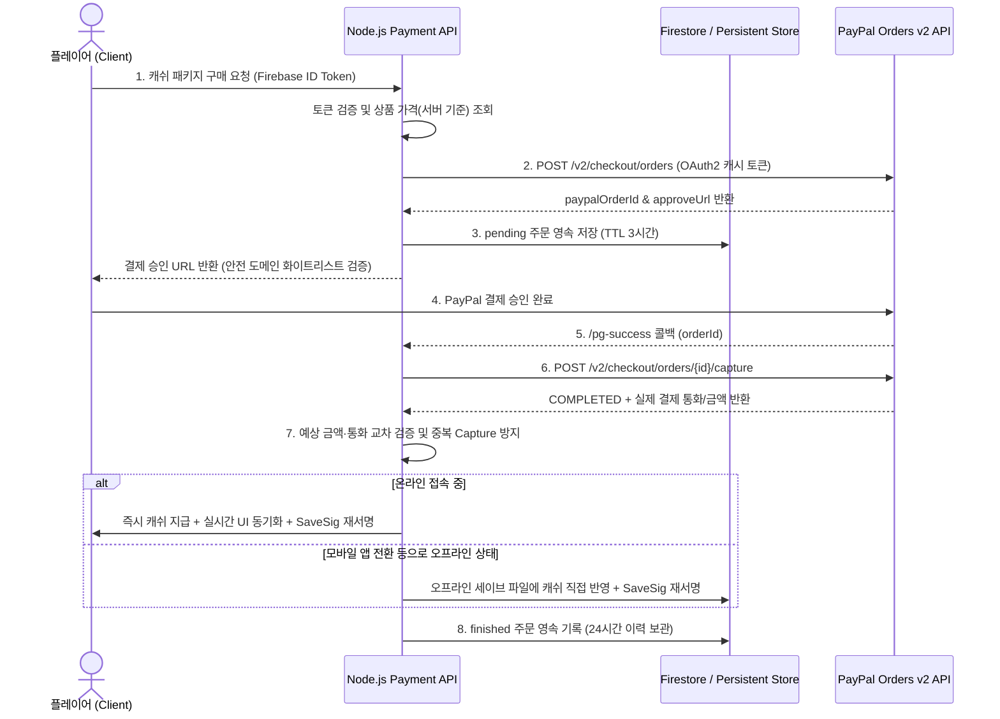

### 4-4. 인게임 경제 순환 & 골드 싱크 (Economy & Gold Sink)
유료 캐쉬와 별개로 인게임 골드 경제가 인플레이션으로 붕괴되지 않도록 **소비처(Gold Sink)**를 다층적으로 배치했습니다.
- **별빛 카지노 (`client/src/ui/Casino.ts`)**: 밤 시간대(`18:00~06:00`) 한정 개장하는 슬롯머신·주사위·하이로우 미니게임으로 중후반 잉여 골드를 재미있게 회수합니다.
- **모험 유지비 & 업그레이드**: 도구 내구도 소모 및 단계별 강화(구리→철→금→별빛), 마을 숙소(500G), 별바람 택시(빠른 이동), 17개 마을 특산 씨앗 구매.

---

## 5. 주요 기술적 도전과 해결 (Troubleshooting & Engineering Highlights)

| 직면한 과제 | 해결 전략 및 구현 결과 |
|---|---|
| **1. 싱글플레이와 멀티플레이 로직 이중화 위험** | `Authority` 인터페이스로 네트워크 계층을 추상화하고, 핵심 규칙을 `shared/sim/`에 단일화. 동일한 씬 코드로 오프라인 스토리 모드와 실시간 멀티플레이를 완벽히 호환. |
| **2. 178개 대규모 맵의 워프 누락 및 퍼즐 길막 버그** | 수작업 대신 `region-spec.mjs` 기반 선언적 맵 생성 파이프라인을 구축하고, `check-world.mjs`와 BFS 기반 `check-paths.mjs`(체육관 기믹·파도타기 해류 시뮬레이션 포함)를 도입해 전 맵 결점 0건 자동 검증. |
| **3. 모바일 웹 결제 중 소켓 끊김으로 인한 캐쉬 미지급** | PayPal 주문 상태(`pending`/`finished`)를 Firestore에 영속화하고, 결제 Capture 시점에 유저가 오프라인이면 `loadOfflineSave`/`saveOfflineSave` 훅으로 세이브 데이터에 직접 안전 지급 및 무결성 서명(`computeSaveSig`) 갱신. |
| **4. 웹 게임 특유의 로컬 세이브·패킷 변조 취약점** | 모든 주요 판정을 서버 권한으로 처리하고, 오프라인 세이브에는 FNV-1a 무결성 해시를 적용. 적발 시 단순 차단이 아닌 **별빛 교도소(노역/탈옥·갱생)** 콘텐츠로 승화해 보안성과 게임성을 동시 확보. |
| **5. 1인/소규모 개발 환경에서의 막대한 리소스 병목** | 픽셀아트(`tools/art/*.mjs`), 28곡 BGM 및 11종 발소리(`WebAudio`), 210종 인물 일러스트(`Gemini API` 배치 파이프라인)를 모두 자동화하여 외부 에셋 의존도 0%로 상용급 볼륨 달성. |

---

## 6. 기술 스택 요약 (Tech Stack)

| 영역 | 사용 기술 |
|---|---|
| **Frontend & Game Engine** | TypeScript 5.8, Vite 6, Phaser 3.90, Three.js 0.170, Tailwind CSS 4, WebAudio API |
| **Backend & Realtime** | Node.js 20+, TypeScript (`tsx`), Socket.io 4.8, HTTP REST API |
| **Database & Auth** | Firebase Authentication (Google OAuth / JWT 검증), Cloud Firestore |
| **Payment & BM** | PayPal REST Orders v2 API (OAuth2, Create/Capture, Persistent Order Queue) |
| **Procedural & AI Tools** | Custom PNG Encoder (`node:zlib`), Cellular Automata Cave Gen, BFS Path Validator, Gemini Image API |
| **Infrastructure & CI** | Vercel (Frontend), Azure App Service (Backend WebSocket), GitHub Actions |
